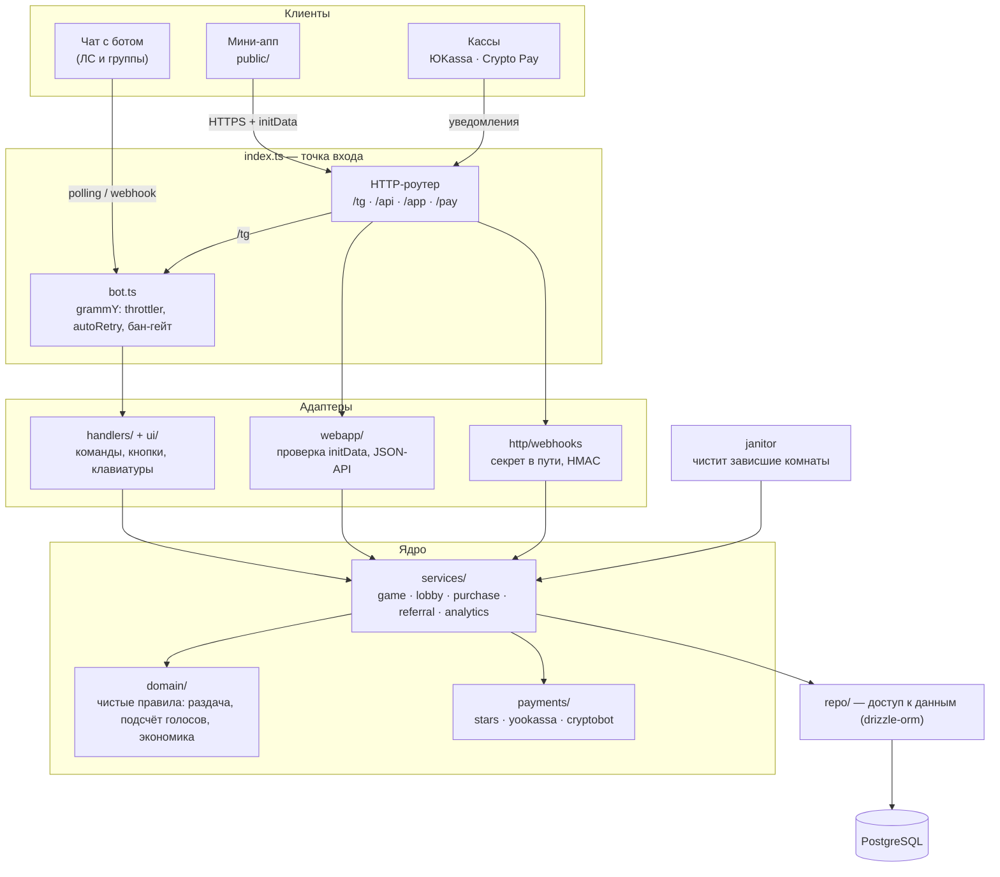

# 🐒 Обезьянка

Telegram-бот для офлайн-пати-игры. Компания сидит вместе, у каждого телефон.
Всем приходит одинаковая карточка из 10 действий, одному — «ты обезьянка».
По сигналу все резко делают действие №N, обезьянка подстраивается. В конце — голосование.

Полные правила, архитектура и план — в [PLAN.md](PLAN.md).

## Статус

| Этап | Состояние |
|---|---|
| 1. Каркас: комнаты, лобби, QR, вход по коду и из группы | ✅ готово |
| 2. Раздача карточек, раунды, синхронный сигнал | ✅ готово |
| 3. Голосование, пропуск, переголосование | ✅ готово |
| 4. Надёжность: блокировки комнат, выпадение игроков, janitor | ✅ готово |
| 5. Свои коды комнат, замок входа | ✅ готово |
| 6. Статистика: события, агрегаты, `/stats` | ✅ готово |
| 7. Обратная связь и ответы админов | ✅ готово |
| 8. Админ-панель в боте | ✅ готово |
| 9. Логи: pino, Sentry, журнал действий админов | ✅ готово |
| 10. Рассылки, веб-дашборд | ⏳ следующее |
| 11. Магазин колод, оплата, личный счёт | ✅ готово |
| 12. Реферальная программа | 🧩 каркас: приглашения считаются, бонусы выключены |
| 13. Мини-апп: комната, карточка, сигнал, голосование, магазин | ✅ MVP |

Разбор состояния и дизайн этих задач — в [PLAN-2.md](PLAN-2.md).

## Стек

Node 22 · TypeScript · [grammY](https://grammy.dev) · PostgreSQL · drizzle-orm

Мини-апп — статическая страница без сборки: HTML, CSS и один файл на ванильном JS.

## Архитектура

Один процесс Node: бот в Telegram, HTTP-сервер для мини-аппа и вебхуков касс,
фоновый janitor. Все три входа сходятся в общий слой сервисов — правила игры
и выдача покупок написаны в одном месте, а не продублированы под каждый клиент.



**Слои.** `domain/` — чистые функции без ввода-вывода (раздача ролей, кворум,
подсчёт голосов, цены). `repo/` — единственное место, где пишется SQL.
`services/` — сценарии, которые склеивают одно с другим. `handlers/` и `webapp/`
— тонкие адаптеры: разобрать запрос, позвать сервис, отрисовать ответ.

**Ключевые решения.**

- **Блокировка на комнату** (`lib/mutex.ts`) — все переходы партии идут
  последовательно, поэтому два голоса в одну миллисекунду не считаются дважды.
- **Партия переживает рестарт** — состояние пишется в базу, при старте
  `recoverGames` поднимает живые игры и сообщает игрокам.
- **Один источник истины для двух клиентов** — мини-апп не хранит состояние,
  а забирает снимок с сервера, потому что ту же партию параллельно ведёт бот в чате.
  Подробнее — в разделе [Мини-апп](#как-это-устроено).
- **Идемпотентная выдача покупок** — путей оплаты три, точка выдачи одна
  (`services/purchase.ts`), повторный вебхук ничего не выдаёт второй раз.
  Подробнее — в разделе [Оплата](#как-это-устроено-внутри).
- **Аналитика не тормозит игру** — события копятся в памяти и пишутся пачками.

## Локальный запуск

Docker локально нет, поэтому Postgres ставится через Homebrew:

```bash
brew install postgresql@17
brew services start postgresql@17
```

Создать базу и пользователя:

```bash
psql postgres -c "CREATE USER obezyanka WITH PASSWORD 'obezyanka' SUPERUSER;"
psql postgres -c "CREATE DATABASE obezyanka OWNER obezyanka;"
```

Бот в [@BotFather](https://t.me/BotFather): `/newbot` → получить токен.
Юзернейм бота обязательно продублировать в `BOT_USERNAME` — на нём держатся deep-link и QR.

```bash
cp .env.example .env
```

Дальше:

```bash
npm install
npm run db:migrate
npm run db:seed
npm run dev
```

## Команды

### Команды бота

| Команда | Кому |
|---|---|
| `/start`, `/room`, `/leave`, `/rules` | всем |
| `/app` | открыть мини-апп (если поднят) |
| `/stats` | своя статистика: партии, роль обезьянки, точность голосов |
| `/shop`, `/balance` | магазин колод и личный счёт |
| `/invite` | пригласительная ссылка |
| `/paysupport` | вопросы по оплате (обязательна по правилам Telegram) |
| `/feedback` | написать разработчикам; ответ придёт в тот же чат |
| `/privacy`, `/forget_me` | что бот хранит и как это обезличить |
| `/admin` | панель; видна только тем, кто в `ADMIN_IDS` или в таблице `admins` |

### Скрипты

| Команда | Что делает |
|---|---|
| `npm run dev` | бот с автоперезапуском (long polling) |
| `npm run dev:webapp` | только мини-апп, без бота — для вёрстки |
| `npm run typecheck` | проверка типов |
| `npm run build` / `npm start` | сборка и запуск прода |
| `npm run db:generate` | сгенерировать миграцию из `src/db/schema.ts` |
| `npm run db:migrate` | применить миграции |
| `npm run db:seed` | залить колоды из `src/content/decks/*.json` |
| `npm run check:money` | прогнать денежную логику по живой базе (кошелёк, идемпотентность, рефералы) |
| `npm run check:security` | инъекции, разметка в сообщениях, доступ к вебхукам, обход оплаты |
| `npm run check:webapp` | подпись `initData`: подмена id, чужой токен, просрочка |
| `npm run check:miniapp` | мини-апп целиком: статика, доступ к API, полная партия по HTTP |
| `npm run db:studio` | веб-просмотр базы |

## Как играть (что уже работает)

**В личке:** `/start` → «Создать комнату» → бот присылает QR и код.
Остальные сканируют QR с экрана админа или вводят код — и попадают в общее лобби,
которое обновляется у всех сразу.

**В групповом чате:** добавить бота в чат → `/game` → кто ведущий, жмёт кнопку.
Комната создаётся у него в личке, а в чат прилетает код и кнопка входа.
Карточки в любом случае уходят в личку.

Админ выбирает колоду и частоту голосований, может задать **свой код**
(`✏️ Свой код` → например `MONKEY`) и запереть вход, когда все собрались.
Дальше жмёт «Начать игру».

Дальше всем приходит **карточка** — она висит открытой всю партию —
и **сигнальное сообщение**. Админ жмёт «Погнали» → у всех отсчёт 3-2-1 →
одновременно прилетает номер действия, обезьянке вместо номера — 🐒.

Играем **до победы одной из сторон**: после каждого раунда (или каждых 2-3,
как настроит админ) запускается голосование в личке. Кто не определился —
жмёт «⏭ Пропустить»; если пропустило большинство, бюллетень не засчитывается
и роли не раскрываются. В последнем раунде пропустить нельзя. При ничьей —
переголосование между лидерами. Поймали обезьянку — победили мирные;
продержалась все 10 раундов — победила она.

Игра переживает перезапуск бота: состояние лежит в БД, при старте партии
восстанавливаются и админ продолжает с текущего раунда.

## Мини-апп

Второй клиент к той же игре: комната, карточка, сигнал, голосование, магазин и
профиль — на одном экране внутри Telegram. Бот никуда не делся и остаётся
основным: карточка и сигнал по-прежнему приходят сообщениями в личку, поэтому
закрытое посреди партии приложение ничего не ломает.

### Как открыть

| Способ | Что для этого нужно |
|---|---|
| Кнопка слева от поля ввода | ставится сама при старте, если задан `WEBAPP_URL` |
| Кнопка «🚀 Открыть приложение» в `/start` | то же |
| `/app` | то же |
| Ссылка `t.me/<бот>/<приложение>` | завести приложение в @BotFather (`/newapp`) и вписать имя в `WEBAPP_SHORT_NAME` |

### Локально

Telegram открывает только `https`, поэтому нужен туннель:

```bash
cloudflared tunnel --url http://localhost:3000
```

Выданный адрес плюс `/app` — в `WEBAPP_URL`, и `npm run dev`.

Верстать удобнее в обычном браузере: поставить `WEBAPP_DEV_TG_ID=<свой tg_id>`
и запустить `npm run dev:webapp` — поднимется только мини-апп, без приёма
апдейтов, и API будет пускать без подписи Telegram. Лазейка действует только
для запросов на `localhost` и никогда при `NODE_ENV=production`: туннель
поднимают на той же машине, где верстают, и без этого ограничения публичный
адрес пускал бы кого угодно под чужим `tg_id`.

**Если cloudflared не подключается.** Ему нужен порт 7844 наружу — UDP для QUIC
и TCP для запасного HTTP/2. VPN с TUN-интерфейсом (v2RayTun, V2Box и подобные)
обычно роняет и то, и другое: в логе будет `TLS handshake with edge error`
с локальным адресом вида `198.18.0.1`. Варианты: отключить VPN, прописать в нём
обход для `*.argotunnel.com`, либо взять туннель поверх 22/443 —

```bash
ssh -R 80:localhost:3000 nokey@localhost.run
```

Он выдаёт `https://<...>.lhr.life` без промежуточной страницы-заглушки,
которая ломала бы WebView (в отличие от бесплатных ngrok и localtunnel).

Чтобы прокликать игровые экраны в одиночку, добавь `WEBAPP_FAKE_TELEGRAM=1`:
партия рассылает карточки в личку, и без настоящих чатов игроки вылетают прямо
на раздаче.

### Как это устроено

**Личность.** Страница живёт в браузере, то есть всё, что она присылает,
приходит от кого угодно. Единственное, чему можно верить, — строка `initData`:
Telegram подписывает её ключом, выведенным из токена бота. Сервер пересчитывает
подпись (`webapp/auth.ts`) и только после этого узнаёт, кто пришёл. Ни `user.id`
из тела запроса, ни заголовки личностью не считаются.

**Состояние.** Клиент своего состояния не держит вовсе. Он раз в секунду просит
`GET /api/state` — один снимок на всё приложение — и перерисовывает экран
целиком; ответ на любое действие тоже содержит свежий снимок. Причина в том,
что тех же людей одновременно обслуживает бот в чате: две копии истины
разъехались бы на первом же голосовании.

**Правила.** Ручки в `webapp/api.ts` намеренно тонкие: они проверяют подпись,
находят пользователя и зовут ровно те же функции, что и кнопки в чате
(`services/game.ts`, `services/lobby.ts`). Отдельной реализации правил для
мини-аппа нет и быть не должно — она бы отстала.

**Что не уезжает в браузер.** Чужие роли до финала и номер действия до сигнала.
Всё, что попало в ответ API, считается раскрытым, даже если мы это не нарисовали:
обезьянке хватило бы вкладки «Сеть».

**Отсчёт.** Единственное место, где важны доли секунды. Сервер отдаёт не цифру,
а момент сигнала (`revealAt`), и 3-2-1 клиент рисует сам — иначе каждая цифра
стоила бы запроса.

### Ручки

| Метод | Что делает |
|---|---|
| `GET /api/state` | снимок: профиль, счёт, комната, партия, колоды |
| `POST /api/room/create` · `join` · `leave` · `close` | комната |
| `POST /api/room/qr` | PNG-QR комнаты (data-URI, по нажатию — не в снимке) |
| `POST /api/room/deck` · `voteEvery` · `lock` · `start` | настройки и старт (только ведущий) |
| `POST /api/game/go` · `voting` · `vote` · `skip` · `end` | партия |
| `POST /api/shop/buy` | счёт в Stars (`openInvoice`) или списание с 🍌 |

Статика — на `/app`, там же лежат `styles.css` и `app.js`.

## Колоды

Лежат в `src/content/decks/*.json`, заливаются через `npm run db:seed` (идемпотентно — можно гонять сколько угодно).

Содержимое колоды правится и из панели: **🎴 Колоды → колода → «➕ Добавить действия»
или «♻️ Заменить все»**, дальше присылаешь список ответом на приглашение —
одно действие на строку. Нужна роль `moderator` и выше. Идущие партии не
затрагиваются: они играют по снапшоту, снятому на старте.

⚠️ `npm run db:seed` перезаписывает **содержимое** колод из JSON-файлов,
то есть затирает правки действий из панели. Если правишь действия из панели —
либо не гоняй seed, либо перенеси изменения в `src/content/decks/*.json`.
Цены и флаг «в продаже» seed не трогает: они правятся из панели и живут в базе.

| Колода | Доступ |
|---|---|
| Базовая | бесплатно |
| Для незнакомых компаний | 100 ⭐ / 100 ₽ / 100 🍌 |
| Хардкор | 100 ⭐ / 100 ₽ / 100 🍌 |
| 18+ | 100 ⭐ / 100 ₽ / 100 🍌 |

Цены живут в базе и правятся из панели (**💰 Оплата → 🎴 Тарифы колод**), поэтому
`npm run db:seed` их **не** перетирает — в отличие от названий и содержимого.
Права на платные колоды лежат в `user_decks`; выдать вручную можно из панели
(**👤 Пользователи → «➕ Выдать»**) или запросом:

```sql
INSERT INTO user_decks (user_id, deck_id) VALUES (1, 2) ON CONFLICT DO NOTHING;
```

## Админ-панель

Свой `tg_id` (узнать у [@userinfobot](https://t.me/userinfobot)) в `.env`:

```
ADMIN_IDS=12345678
ADMIN_CHAT_ID=-1001234567890
```

`ADMIN_IDS` — владельцы, их нельзя потерять из таблицы. Роли `moderator`
и `support` живут в таблице `admins`; кнопки для их назначения в панели пока
нет — добавлять приходится SQL-запросом. `ADMIN_CHAT_ID` — служебный чат,
куда падают обращения: несколько админов видят одно и то же и не дублируют
ответы. Если не задан, уведомления уходят каждому админу в личку.

В панели: статистика за сегодня / 7 / 30 дней, инбокс обращений с ответами,
поиск пользователя и выдача колод, редактирование действий в колодах,
живые комнаты с принудительным закрытием, лидерборд, состояние процесса.

Раздел **💰 Оплата** (`moderator` и выше на просмотр, `owner` на изменения):

| Экран | Что можно |
|---|---|
| 🎴 Тарифы колод | цена в ₽ / ⭐ / 🍌 по отдельности, платная ↔ бесплатная, снять с продажи |
| 🔌 Способы оплаты | включить и выключить Stars, ЮKassa, крипту, оплату со счёта |
| 🎁 Рефералка | включить программу, размеры бонусов, процент с покупок, потолок, курс пополнения |
| 🧾 Платежи | последние платежи и возврат в один клик |

Цена `0` означает «этим способом колоду купить нельзя». Провайдер без ключей
в окружении помечен ⚠️ и не включается — иначе человек дошёл бы до кнопки
«Оплатить» и упёрся в ошибку кассы.

Три числа, на которые смотреть каждый день:

- **winrate обезьянки** — норма 40–50%; уходит вверх, значит карточки слишком
  похожи, вниз — обезьянку палят мгновенно;
- **доля доигранных партий** — падает, значит где-то скучно или что-то ломается;
- **p95 разброса сигнала** — растёт, значит упёрлись в лимиты Telegram
  и синхронность поехала.

## Оплата

### Почему Stars, а не ЮKassa

Правила Telegram для разработчиков ботов ([Bot Developers ToS, п. 6.2](https://telegram.org/tos/bot-developers))
требуют, чтобы **цифровые товары внутри бота продавались только за Telegram Stars**:
приложения Telegram лежат в App Store и Google Play, а те требуют, чтобы цифровой
контент в приложении покупался их средствами. Колоды — цифровой товар, поэтому
приём рублей за них прямо в боте нарушает правила и грозит блокировкой бота.

Практическая сторона у Stars тоже неплохая: не нужны ни ИП, ни самозанятость,
ни договор эквайринга, ни онлайн-касса по 54-ФЗ — Telegram выступает продавцом.
Вывод — через [Fragment](https://fragment.com) в TON, каждая звезда доступна
к выводу через 21 день, минимум 1000 звёзд. По ходовым оценкам 1000 ⭐ — это
около 7,8 TON, то есть примерно 1050–1100 ₽ на руки. Поэтому дефолтный тариф
и стоит «100 ⭐ ≈ 100 ₽»: у владельца на руках выходит сопоставимо.

Обратная сторона: пользователь платит за звёзды дороже номинала (Apple и Google
берут своё), Fragment требует кошелёк TON, а деньги приходят с задержкой.

### Что с ЮKassa и криптой

Адаптеры написаны, оттестированы и **выключены по умолчанию**. Они нужны там,
где ограничение Telegram не действует:

- внешняя витрина (сайт, оплата вне бота);
- физические товары — печатные колоды, мерч;
- если правила Telegram изменятся.

| Провайдер | Комиссия | Что нужно | СБП |
|---|---|---|---|
| Telegram Stars | ~30% суммарно (сторы + Telegram) | ничего | — |
| [ЮKassa](https://yookassa.ru/fees/) | от 2,8% карты, от 0,4% СБП; самозанятым от 0,4%, но не более 1500 ₽ за платёж | ИП / ООО / самозанятость | ✅ |
| Crypto Pay ([@CryptoBot](https://t.me/CryptoBot)) | ~3% на выплату | только токен приложения | — |

Robokassa и Prodamus сравнимы с ЮKassa по деньгам; ЮKassa выигрывает зрелостью
API и тем, что самозанятый подключается за минуты. Отдельного смысла тащить
третьего провайдера ради СБП нет — у ЮKassa он самый дешёвый способ приёма.

### Подключение внешних касс

1. Сгенерировать секрет пути и положить его в `WEBHOOK_PATH_SECRET`:

```bash
openssl rand -hex 24
```

2. Прописать ключи в `.env` (см. `.env.example`) и перезапустить бота.
   В логе появятся готовые пути вебхуков.
3. Указать эти пути в личном кабинете: ЮKassa — `https://ваш-домен/pay/yookassa/<секрет>`
   (события `payment.succeeded` и `payment.canceled`), Crypto Pay — `https://ваш-домен/pay/crypto/<секрет>`.
4. Включить провайдера в панели: **💰 Оплата → 🔌 Способы оплаты**.

HTTP-сервер поднимается и в режиме `polling`, если касса настроена, —
уведомлениям иначе некуда прийти.

### Как смотреть логи при тестировании

Весь путь денег помечен `mod=pay` — от «нажал купить» до выдачи товара:

```bash
npm run dev | grep '"mod":"pay"'
```

По умолчанию на `info` видно ключевые шаги: `order_created` → `checkout_ready` →
`pre_checkout` → `successful_payment` (или уведомление кассы) → `settled` →
`deliver`, плюс `referral_bonus`, `refund_start` / `refund_done` и все отказы
с причиной. В каждой строке есть `orderId`, так что одна покупка вытягивается
целиком:

```bash
journalctl -u obezyanka -f | grep 'oa74e8a38b68a4'
```

`PAYMENTS_LOG_LEVEL=debug` добавляет тела запросов к кассам и содержимое
вебхуков — не заливая дебагом остальной бот. Ключи, токены и заголовок
`Authorization` не логируются ни на каком уровне; неверный секрет из пути
вебхука тоже не пишется — иначе журнал сам накапливал бы подсказки к подбору.

Продуктовые события той же цепочки видны и в панели:
**📜 Журнал → Оплата** (`purchase_started`, `purchase_paid`, `referral_bonus`).

### Как это устроено внутри

Приход денег идёт тремя разными путями (апдейт Telegram, вебхук кассы, списание
со счёта), но **выдача одна** — `services/purchase.ts`. Заказ переводится из
`pending` условным `UPDATE`, поэтому повторный вебхук — а он штатно случается
при таймауте — не выдаёт товар дважды. Телу уведомления ЮKassa не верим вообще:
берём оттуда только id и перечитываем платёж через API, потом сверяем сумму
с заказом. Crypto Pay подписывает тело — проверяем HMAC.

Списание с личного счёта тоже защищено базой, а не приложением: условие
`balance >= amount` стоит внутри самого `UPDATE`, поэтому два одновременных
списания не уводят счёт в минус. Это проверяется в `npm run check:money`.

### 🍌 Внутренний счёт

Внутренняя валюта — бананы. Ей платят за колоды, ею же начисляются реферальные
бонусы. Вывести или обменять на деньги нельзя — это осознанно: так счёт остаётся
скидочным механизмом, а не платёжным средством со всеми вытекающими требованиями.

Баланс лежит в `wallets`, все движения — в `wallet_ledger` (со знаком и
с `balance_after`), поэтому любой спор «куда делись бананы» разбирается по журналу.

## Что проверено на устойчивость

`npm run check:security` бьёт по настоящим функциям настоящими нагрузками:

| Класс | Что проверяется |
|---|---|
| SQL-инъекции | `'; DROP TABLE users; --`, `' OR '1'='1`, `UNION SELECT`, `pg_sleep` — через поиск в панели, реферальные коды и id заказов. Drizzle параметризует всё; после прогона таблицы на месте, а подстановка в `LIKE` не выдаёт чужие строки |
| Разметка в сообщениях | имя игрока полностью под контролем атакующего — `<b>`, `<a href>`, `<script>` в имени не должны становиться разметкой в сообщениях с `parse_mode=HTML` |
| Доступ к вебхукам | секрет сравнивается посимвольно по всей длине; проверяются изменённый символ, другая длина, секрет в query, `GET`, выход из каталога, переразмерное тело. Есть **положительный контроль** — верный секрет и верная подпись обязаны проходить, иначе тест «всё отвергается» ничего не значит |
| Подпись Crypto Pay | без подписи, чужая подпись, правка подписанного тела → 403 |
| Обход оплаты | выдача по несуществующему заказу, покупка без денег, отрицательные суммы и отрицательные цены |
| Накрутка рефералов | самоприглашение, перехват чужого реферала, запись «старого» пользователя |

Чего эти проверки **не** покрывают: боевые ключи касс (прогон идёт на подставных),
реальные сети и лимиты Telegram, и поведение под настоящей нагрузкой.

## Реферальная программа

Программа **ещё не спроектирована** — включена только её учётная часть.

Работает уже сейчас: у каждого есть личная ссылка (`/invite`, кнопка «🎁 Пригласить»),
переходы по ней записываются в `referrals`. Это сделано намеренно: связь
«кто кого привёл» задним числом не восстановить, а бонусы за неё можно
доначислить когда угодно.

Выключено по умолчанию: сами начисления. Включаются в панели
(**💰 Оплата → 🎁 Рефералка**), там же настраиваются размеры.

Правила привязки жёсткие, иначе программу тривиально накрутить:

- себя пригласить нельзя;
- один пригласивший на человека навсегда, кто успел — тот и привёл;
- засчитывается только тому, кто впервые запустил бота меньше 5 минут назад,
  иначе давнего пользователя можно было бы задним числом записать в рефералы.

Что начисляется, когда программу включат: приглашённому — приветственные 🍌 сразу,
пригласившему — разовый бонус за первую покупку друга и процент со всех
последующих, с необязательным потолком на одного реферала.

Точка расширения — `payReferralCut()` в `services/purchase.ts`. Если бонус
понадобится платить не за покупку, а, скажем, за первую доигранную партию,
добавляется вызов из движка партии; вся остальная механика уже на месте.

## Логи

Два независимых слоя — они отвечают на разные вопросы.

**События в БД** (`events`) — что происходило в продукте. Пишутся пачками из буфера
в памяти, поэтому не стоят на пути синхронного сигнала. 18 типов: запуск бота, жизненный
цикл комнат и партий, голосования, обращения, `deck_locked_hit` (спрос на платные колоды),
`round_played` с разбросом доставки сигнала и `admin_action` — журнал привилегированных
действий: бан, выдача колоды, закрытие чужой комнаты, смена статуса обращения.

Смотреть в панели: `/admin` → «📜 Журнал» (действия админов или все события).
Или напрямую:

```bash
psql -U obezyanka -d obezyanka -c "SELECT created_at::time(0), type, user_id, payload FROM events ORDER BY id DESC LIMIT 30;"
```

**Технический лог** (`pino`) — что происходило с процессом. В dev читаемый вывод
в терминал, в проде JSON в stdout: его подхватывает docker/systemd, и по нему можно
искать по `roomId`, `gameId`, `tgId`. Уровень задаётся `LOG_LEVEL`; на `debug`
дополнительно печатается каждый входящий текст с типом чата и наличием `reply_to`.

Ошибки из `bot.catch` уходят и в лог, и в Sentry, если задан `SENTRY_DSN`.
Без DSN Sentry просто не поднимается.

## Деплой на VPS

```bash
cp .env.example .env   # заполнить BOT_TOKEN, BOT_USERNAME, POSTGRES_PASSWORD
docker compose up -d --build
docker compose exec bot node dist/db/migrate.js
docker compose exec bot node dist/db/seed.js
```

Для webhook в `.env`: `BOT_MODE=webhook`, `WEBHOOK_URL=https://домен/tg`, `WEBHOOK_SECRET=…`
и nginx с TLS, проксирующий `/tg` на `127.0.0.1:3000`.

## Структура

```
src/
├─ config.ts          переменные окружения, deep-link, админы
├─ bot.ts             сборка бота, throttler, autoRetry, бан-гейт, порядок хендлеров
├─ index.ts           точка входа: polling или webhook, janitor, восстановление партий
├─ domain/            rules (все числа игры), game (раздача, кворум, подсчёт голосов), economy (валюта, тарифы)
├─ lib/               mutex, debounce, lru, ratelimit, code, pending
├─ db/                схема, миграции, сид
├─ repo/              users, decks, rooms, admins, feedback, stats, gameStats, payments, wallet, referrals, settings
├─ payments/          адаптеры касс: stars, yookassa, cryptobot + общий контракт
├─ http/              вебхуки внешних касс
├─ webapp/            мини-апп: проверка initData, снимок состояния, JSON-API, статика
├─ public/            страница мини-аппа: index.html, styles.css, app.js
├─ services/          game (движок партии), lobby, analytics, janitor, qr, purchase, referral
├─ handlers/          start, lobby, group, game, feedback, profile, admin, shop
├─ ui/                отрисовка сообщений и клавиатур
├─ dev/               прогоны по живой базе: деньги, безопасность, мини-апп; сервер мини-аппа без бота
└─ content/decks/     колоды
```

`lib/mutex.ts` — по одной цепочке промисов на комнату. Все переходы FSM партии
идут под ней, иначе два голоса, пришедшие в одну миллисекунду, считаются дважды.

`services/analytics.ts` — буфер в памяти + пакетная вставка. Запись события
никогда не стоит на пути синхронного сигнала.

`webapp/state.ts` — единственный ответ на чтение для мини-аппа. Клиент не
спрашивает «что изменилось», он забирает картинку целиком: у той же игры есть
второй клиент — бот в чате, — и синхронизировать два независимых состояния
дороже, чем перерисовать экран.

`services/purchase.ts` — единственное место, где выдаётся оплаченное.
Путей прихода денег много (звёздный апдейт, вебхук кассы, списание со счёта),
а точка выдачи одна, и она идемпотентна: заказ переводит из `pending` условный
`UPDATE`, поэтому повторный вебхук не выдаёт товар второй раз.
